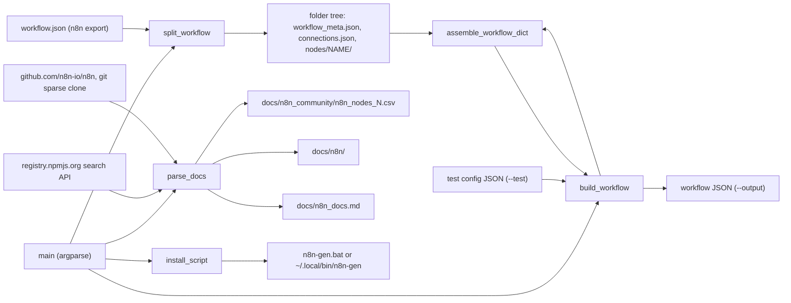

# n8n-py-generator: documentation hub

`n8n-py-generator` is a single-module Python console tool (`n8n_gen.py`) for
keeping an exported n8n workflow as a folder tree instead of one JSON file.
`split` writes one folder per node and moves Code-node source into `code.js` /
`code.py`; `build` assembles the tree back into a workflow JSON, optionally
disabling nodes or replacing them with mock Code nodes; `docs` downloads n8n
node references (npm community packages, built-in node sources) for an AI
agent; `install` puts an `n8n-gen` command on PATH (`README.md:3-8`). Who uses
it beyond the author is not stated in the repository.

The requirements specification is [`../SPEC.md`](../SPEC.md).

## 1. Status

| Item | State | Source |
| --- | --- | --- |
| Documented commit | `554a79e`, 2026-11-08, merge of `test` into `release` | `git log -1` |
| Last change to `n8n_gen.py` | `ee7dc83`, 2026-11-08, import order, two empty f-string prefixes, an unused `as status` alias and `ruff format` ("No behaviour changes") | `git log -- n8n_gen.py`, `git show ee7dc83` |
| Last behaviour change | `2b4b121`, 2026-05-04, test mode (disable and mock) | `git log -- n8n_gen.py` |
| Package version | `1.0.0` | `pyproject.toml:16`, `recipe.ps1:13` |
| Tests | `tests/test_n8n_gen.py`: 23 test functions, one parametrized with 5 cases (27 cases). `tests/test_manual_list.py`: 2. An independent run of `uv run --frozen python -m pytest` on 2026-11-19 gave 29 passed, coverage 93.73 % | `tests/` |
| Coverage floor | 93 % of `n8n_gen`; 93.7 % "measured on adoption" | `pyproject.toml:70-71` |
| CI | Five Gitea workflows in `.gitea/workflows/`; `test.yaml` runs on push to `test`, nightly at 03:00 and by hand, on a `windows` runner. No `.github/` folder, so the GitHub copy runs no Actions. Whether a runner has executed them is not recorded in the repository | `.gitea/workflows/test.yaml:2-16` |
| Manual tests | `tests/manual/tests.json` holds an empty list | `tests/manual/tests.json` |
| Open lab exceptions | R-02 (#8), R-09 (#9), R-41 (#10), R-42 (#11); the issue numbers refer to the lab's Gitea server | `README.md:27` |
| TODO / FIXME markers in own code | none | search over `n8n_gen.py`, `tests/`, `docs/` |

Evidently unfinished: no test or fixture uses a real n8n export, and nothing
in the repository checks that a built workflow imports into n8n (see
"Known limitations").

## 2. Layout

| Path | What it is |
| --- | --- |
| `n8n_gen.py` | The whole tool: `split_workflow`, `assemble_workflow_dict`, `build_workflow`, `parse_docs`, `install_script`, `main` (426 lines) |
| `tests/test_n8n_gen.py` | pytest suite for `n8n_gen`; network and `git` calls are replaced by fakes |
| `docs/install.md` | Author's install notes |
| `docs/manual.md` | Author's command reference, folder-tree layout, test-configuration format |
| `pyproject.toml` | Package metadata, dependencies, entry point `n8n-gen`, pytest/mypy/ruff settings |
| `uv.lock` | Pinned versions of all dependencies |
| `README.md`, `LICENSE` | Overview; MIT licence |
| `CLAUDE.md`, `CONTRIBUTING.md` | Repository rules for contributors and for Claude Code |
| `recipe.ps1`, `.claude/`, `.gitea/`, `tests/manual/`, `tests/test_manual_list.py`, `tools/wiki.py` | Lab tooling (see "Repository tooling") |
| `docs/n8n/`, `docs/n8n_community/`, `docs/n8n_docs.md`, `n8n_temp/` | Written by `docs`; gitignored (`.gitignore`) |
| `dist/` | Wheel written by `recipe.ps1 build`; gitignored |

## 3. Architecture

One module, no classes. `main()` parses the command line with `argparse` and
calls one function per command (`n8n_gen.py:390-422`). All console output goes
through a `rich` logging handler at INFO level (`n8n_gen.py:27-34`). External
systems are used only by `docs`: the npm registry search API over HTTPS
(`requests`) and `github.com/n8n-io/n8n` through the `git` executable
(`n8n_gen.py:220-221`, `284-293`).



## 4. Build and run

Prerequisites:

- Python 3.13 (`pyproject.toml:20`: `>=3.13,<3.14`; `uv.lock:3`).
- uv; no version is pinned in the project files (`docs/install.md:3`).
- PowerShell for `recipe.ps1` (CI uses `shell: powershell`, `.gitea/workflows/test.yaml:11`).
- For `docs` only: `git` on PATH and access to `registry.npmjs.org` and `github.com` (`docs/install.md:5`).

| Step | Command | Source |
| --- | --- | --- |
| Install dependencies | `uv sync --frozen` | `docs/install.md:4` |
| Check | `.\recipe.ps1 run --help` (lists the four commands) | `docs/install.md:7` |
| Run a command | `.\recipe.ps1 run <command> [options]` | `docs/manual.md:3-5`, `recipe.ps1:60-63` |
| Same without the recipe | `uv run --frozen python n8n_gen.py <command> [options]` | `recipe.ps1:61` |
| Build a wheel into `dist\` | `.\recipe.ps1 build` | `docs/install.md:11`, `recipe.ps1:48-51` |
| Put `n8n-gen` on PATH | `.\recipe.ps1 run install` | `docs/install.md:9` |

`recipe.ps1` changes into the repository root before it runs anything
(`recipe.ps1:45`), so relative paths given to `recipe.ps1 run` are resolved
from the repository root, not from the caller's folder.

## 5. Configuration

| Name | Kind | Meaning | Default | Source |
| --- | --- | --- | --- | --- |
| `--input`, `-i` | flag of `split` / `build` | workflow JSON file / folder tree to read | required | `n8n_gen.py:396`, `401` |
| `--output`, `-o` | flag of `split` / `build` | folder tree / workflow JSON to write | required | `n8n_gen.py:397`, `402` |
| `--test`, `-t` | flag of `build` | test configuration JSON file | none (no changes) | `n8n_gen.py:403` |
| test configuration | JSON file | object from node name to `"disabled"` or `"mock"` | - | `n8n_gen.py:120-157`, `docs/manual.md:32-43` |
| `nodes/<name>/test.json` | JSON file | items a mocked node returns | - | `n8n_gen.py:128-140` |
| `.env` | file | loaded through `python-dotenv` at import, if that package is importable | - | `n8n_gen.py:19-24` |
| `PATH` | env var | the only variable the code reads; `install` checks whether its target folder is listed | - | `n8n_gen.py:380` |

`docs` has no options; its output folders (`docs/n8n_community`, `docs/n8n`,
`docs/n8n_docs.md`) and the temporary folder `n8n_temp` are fixed and relative
to the working folder (`n8n_gen.py:197-199`, `274`). `recipe.ps1` also loads
`.claude/.env` into the environment (`recipe.ps1:34-43`); that file is
gitignored (`.gitignore`, `CLAUDE.md` rule 4).

## 6. Usage

Edit a workflow's code as files (commands from `README.md:12-17`):

```powershell
.\recipe.ps1 run split --input workflow.json --output src
# edit src\nodes\<node name>\code.js or code.py
.\recipe.ps1 run build --input src --output workflow_generated.json
```

`split` deletes the output folder first if it exists (`n8n_gen.py:45-46`).
`build` emits nodes in the sorted order of their folder names
(`n8n_gen.py:110`, `docs/manual.md:30`).

Build a test variant without real credentials. Put the items a node should
return into `src\nodes\<node name>\test.json`, write a configuration such as
`{ "Fetch leads": "mock", "Send to Slack": "disabled" }` (`docs/manual.md:37`),
then:

```powershell
.\recipe.ps1 run build --input src --output workflow_test.json --test test-config.json
```

A mocked node becomes an `n8n-nodes-base.code` node, `typeVersion` 2, whose
`jsCode` is `return <items>;`, and its `credentials` are removed
(`n8n_gen.py:142-148`). A disabled node keeps its type and credentials and gets
`"disabled": true` (`n8n_gen.py:122-123`).

Collect node references for an AI agent: `.\recipe.ps1 run docs`
(`README.md:16`). Run through the recipe, it writes into this repository's
`docs/` folder, next to this file.

## 7. Testing

`.\recipe.ps1 test` checks that `recipe.ps1` and `pyproject.toml` carry the same
version, sets `core.hooksPath` in the local git config, then runs pytest (with
the coverage floor), mypy, `ruff check .` and `ruff format .` in place
(`recipe.ps1:82-109`). pytest alone: `uv run --frozen python -m pytest`
(`recipe.ps1:99`); its options live in `pyproject.toml:65-71`.

What `tests/test_n8n_gen.py` covers: the split layout and code extraction, the
deletion of an existing output folder, split-then-build round trip on a
four-node synthetic workflow, skipping loose files in `nodes/`, `disabled`
and `mock` (three wrapping cases, missing `test.json`), reading the
configuration from a file, logged failures of split and build, npm paging and
CSV chunks, HTTP error, non-JSON body, empty page, failed `git` clone,
the Windows shim, the symlink path, a failed symlink, command dispatch, help
without a command, and argparse exit code 2. `requests.get`,
`subprocess.run` and `time.sleep` are replaced inside `n8n_gen`
(`tests/test_n8n_gen.py:211-229`).

Not covered: a real n8n export, import into n8n, real network or `git`, nodes
without a name, two names mapping to one folder, unknown modes, a `disabled`
Code node, the exit code of a failed command.

## 8. Known limitations

1. A failed `split`, `build`, `docs` or `install` is logged and the process exits with code 0 (`docs/manual.md:47`; `n8n_gen.py:89-90`, `191-192`; `main` returns nothing).
2. `split` removes an existing output folder with `shutil.rmtree` and does not check what the path is (`n8n_gen.py:45-46`). Inference: `--output .` would remove the working folder's contents.
3. Folder names replace only `/` and `\` (`n8n_gen.py:55`); an unnamed node becomes `Unnamed_Node`. Inference from the code: two names that map to the same folder (`A/B` and `A_B`, or names differing only in case on a case-insensitive file system) share one folder and the later node overwrites `node.json`; characters that Windows forbids in file names (`:`, `*`, `?`, `"`, `<`, `>`, `|`) make `mkdir` fail and the split stops.
4. Only the top-level `parameters.jsCode` and `parameters.pythonCode` are extracted (`n8n_gen.py:63-72`).
5. A Code node named in the test configuration does not get its `code.js` / `code.py` back, whatever the mode, including `disabled` (`n8n_gen.py:159`, `docs/manual.md:43`).
6. A mode other than `disabled` or `mock`, and a configured name that no node has, are ignored without a message (`n8n_gen.py:120-157`).
7. Confirmed by a probe: a `test.json` list that mixes wrapped (`{"json": ...}`) and plain items gets every item wrapped, so the wrapped ones end up nested twice (`n8n_gen.py:136-138`).
8. `requests.get` is called without a timeout (`n8n_gen.py:221`).
9. `docs` saves whatever pages it got before an HTTP or JSON error, and nothing in the output marks the set as incomplete (`n8n_gen.py:223-231`, `258-265`). CSV chunks and `docs/n8n/` files from an earlier, larger run are not removed (`n8n_gen.py:201-202`, `288`).
10. `docs/n8n_docs.md` is written even when both collection steps failed, and its text is fixed: it says "over 8000+ community nodes" whatever count was collected (`n8n_gen.py:300-334`, `317`).
11. The clone step is one `shell=True` string with `&&`, `cd` and `cp -rf` (`n8n_gen.py:284-293`). Inference: on Windows the shell is `cmd.exe`, which has no built-in `cp`, so the step depends on a `cp` executable on PATH. The tests replace `subprocess.run` (`tests/test_n8n_gen.py:219-226`), so this was never exercised.
12. `install`: the PATH check is a case-insensitive substring test (`n8n_gen.py:381`), so an entry that only starts with the target folder suppresses the warning. The Windows folder is built from `Path.home()` (`n8n_gen.py:345`), while `docs/install.md:9` names `%LOCALAPPDATA%`; they differ when that variable is redirected. The shim calls the `python` found on PATH (`n8n_gen.py:351`). The help text says `~/.local/bin/n8n-gen` on every platform (`n8n_gen.py:409`).
13. The lab-requirements link in `README.md:27` points to `127.0.0.1:3000`, which readers of the public repository cannot reach.

## 9. Repository tooling

The repository follows the lab standard behind
[repo-quality-template](https://github.com/IGORSVOLOHOVS/repo-quality-template),
at "revision 4.0.0 of the lab requirements" with the exceptions R-02, R-09,
R-41 and R-42 (`README.md:25-27`). The relaxations are listed in `CLAUDE.md`
("Where this repository is deliberately relaxed").

Project-specific settings in `recipe.ps1`:

| Variable | Value | Source |
| --- | --- | --- |
| `$Name` / `$Code` / `$Version` | `n8n-py-generator` / `npg` / `1.0.0` | `recipe.ps1:11-13` |
| `$Needs`, `$Tools` | empty | `recipe.ps1:15-16` |
| `$App` | not defined: the project ships as a library | `recipe.ps1:18` |
| `$Provides` | `n8n_gen.py` | `recipe.ps1:19` |
| `$Reviewers` | one name | `recipe.ps1:24` |

Verbs: `build` runs `uv build --wheel --out-dir dist`; `run` runs
`uv run --frozen python n8n_gen.py <args>`; `test` as in section 7; `clean`
removes `dist`, `build`, `out`, `.coverage`; `publish` builds the wheel and copies
it to `$env:LAB_SHARE\needs\n8n-py-generator\v1.0.0` and fails when `LAB_SHARE`
is unset; `info` prints the variables; `install` and `uninstall` only print
"nothing to install" / "nothing to uninstall" (`recipe.ps1:47-110`).

Deviations: `.claude/.env` is gitignored and never committed, reversing R-02
(`CLAUDE.md` rule 4, `.gitignore`). CI is under `.gitea/workflows/`, not
`.github/`. Compared by file name with the template clone, this repository has
no `SPEC.md` (until this one), `CHANGELOG.md`, `SECURITY.md`,
`CODE_OF_CONDUCT.md`, `.pre-commit-config.yaml`, `docs/branching.md`,
`docs/workflow.md`, `docs/quality-iso25010.md` or `scripts/`. No manual tests
are defined (`tests/manual/tests.json`).

## 10. Related documents

- [`../README.md`](../README.md): project overview
- [`../SPEC.md`](../SPEC.md): requirements specification
- [`install.md`](install.md): installation
- [`manual.md`](manual.md): command reference and file formats
- [`../CONTRIBUTING.md`](../CONTRIBUTING.md), [`../CLAUDE.md`](../CLAUDE.md): contribution rules
- [`../LICENSE`](../LICENSE): MIT licence

## 11. About this document

Written 2026-11-18 from commit `554a79e` (branch `release`).

Run to check it: `git ls-files`, `git log`, `git show --stat`, `git status -sb`,
`git remote -v`, a file-name comparison of `git ls-files` with the
repo-quality-template clone, text searches over the sources, a Python `ast`
parse of `n8n_gen.py` to list its functions, and an import check that showed
`pandas` is not installed in this environment.

The first draft ran no tests. An independent check on 2026-11-19 installed the
locked dependencies (`uv run --frozen`) and ran: pytest (29 passed, coverage
93.73 %), mypy (no issues), `ruff check .` (passed), `ruff format --check .`
(12 files already formatted), `python n8n_gen.py --help` (lists the four
commands), and a probe of `split`/`build` (unnamed node, sorted node order, a
`disabled` Code node losing its code, an unknown mode, a mixed `test.json`).

Not run: `.\recipe.ps1 test` itself (it writes `core.hooksPath` and formats in
place), `docs` and `install`.
